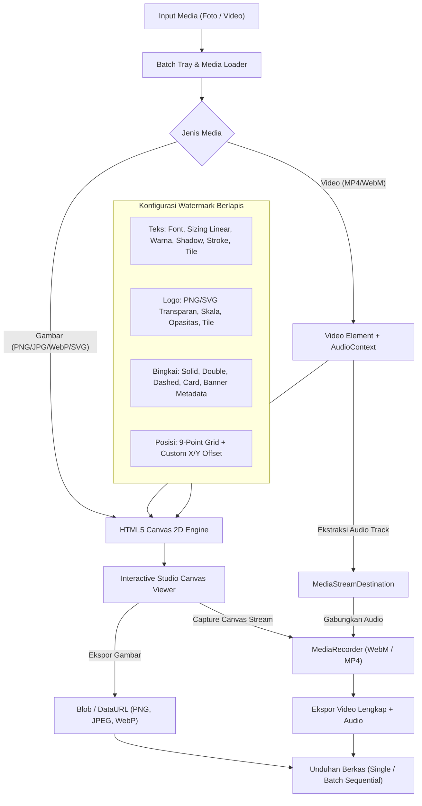

# MarkIt Studio: Studio Watermark Foto dan Video Client-Side

MarkIt Studio adalah aplikasi web dan Progressive Web App (PWA) modern untuk membubuhkan watermark pada foto dan video langsung di browser. Pemrosesan media berjalan 100% di sisi klien (client-side) menggunakan HTML5 Canvas 2D, Web Audio API, dan MediaRecorder API tanpa mengunggah berkas ke server atau cloud pihak ketiga.

Proyek ini dibangun di atas **Next.js 16 (App Router)**, **React 19**, **Tailwind CSS v4**, dan **TypeScript 6 (Strict Mode)** dengan pengelola paket **Bun**.

---

## Arsitektur Pemrosesan Media (Client-Side Pipeline)

Diagram berikut mengilustrasikan alur kerja pemrosesan media di memori browser pengguna:



---

## Fitur Utama

### 1. 100% Client-Side dan Menjaga Privasi
Seluruh proses decoding media, perenderan layer watermark, dan encoding berkas berlangsung lokal di memori browser. Berkas foto dan video Anda tidak pernah dikirimkan ke server eksternal, sehingga data pribadi dan aset rahasia tetap aman.

### 2. Dukungan Gambar, Video, dan Antrean Batch
- **Format Gambar:** PNG, JPEG, WebP, dan SVG.
- **Format Video:** MP4 dan WebM dengan pemutar video interaktif, seek timeline scrubber, pengaturan volume, dan penanda durasi (`mm:ss`).
- **Batch Processing:** Unggah multi-berkas sekaligus melalui drag and drop, terapkan satu konfigurasi watermark ke seluruh antrean, dan pantau status per berkas (Siap, Merender, Selesai).

### 3. Kustomisasi Watermark Berlapis
- **Watermark Teks:**
  - Pilihan 10 jenis huruf terkurasi dari Google Fonts dalam 5 kategori: Modern Sans (Inter, Roboto, Montserrat), Serif (Playfair Display, Merriweather), Display/Bold (Bebas Neue, Oswald), Script/Handwritten (Caveat, Dancing Script), dan Monospace (JetBrains Mono, Geist Mono).
  - Validasi pemuatan huruf via `document.fonts.load()` untuk mencegah fallback kanvas yang tidak terduga.
  - Sistem ukuran persentase linear (0.5% hingga 30.0%) terhadap dimensi minimum media, dilengkapi 5 preset instan (Kecil 2%, Sedang 4.5%, Besar 8%, Ekstra 12%, Jumbo 18%).
  - Warna, transparansi (opasitas), rotasi (-180° hingga 180°), bayangan halus (shadow), dan garis tepi (stroke).
  - Mode ubin diagonal (tile repeating grid) dengan jarak ubin yang dapat disesuaikan untuk melindungi konten dari pemotongan (cropping) atau penghapusan berbasis AI.
- **Watermark Logo:** Unggah logo transparan (PNG/SVG), kendalikan ukuran skala (%), opasitas, rotasi, dan pola ubin logo.
- **Bingkai dan Border:** Gaya garis solid minimalis, garis ganda, garis putus-putus, kartu foto/polaroid, serta banner metadata fotografi bawah ("Shot on MarkIt").

### 4. Penyelarasan Posisi Presisi
- Tombol cepat 9 titik kisi (Top-Left, Top-Center, Top-Right, Middle-Left, Center, Middle-Right, Bottom-Left, Bottom-Center, Bottom-Right).
- Slider offset manual sumbu horizontal (X) dan vertikal (Y) dalam persentase.

### 5. Engine Ekspor Video dan Gambar
- **Ekspor Gambar:** Format PNG, JPEG, dan WebP dengan pengaturan kompresi kualitas.
- **Ekspor Video:** Render video penuh dengan `MediaRecorder` (WebM VP9/VP8 atau MP4 AVC1) yang mempertahankan trek audio asli menggunakan Web Audio API. Dilengkapi indikator progres persentase real-time dan tombol pembatalan render (AbortSignal).
- **Unduh Sekaligus:** Unduh berkas yang sedang aktif atau unduh seluruh antrean batch secara berurutan.

### 6. PWA dan Desain Responsif
- **Progressive Web App (PWA):** Dikonfigurasi dengan Serwist Service Worker untuk performa offline-first dan dapat diinstal langsung di layar beranda ponsel maupun desktop.
- **Mobile-First Layout:** Tata letak responsif dengan kontrol studio yang nyaman digunakan pada berbagai ukuran layar.

### 7. Internasionalisasi dan Tema
- **i18n Native:** Lokalisasi berbasis cookie `NEXT_LOCALE` tanpa prefix segmen URL, mendukung Bahasa Indonesia (`id`, default) dan Bahasa Inggris (`en`).
- **Dark Mode Ready:** Dukungan tema Terang, Gelap, dan Sistem berbasis token Tailwind CSS v4 dan `next-themes`.

### 8. Keamanan Aplikasi dan Proxy Middleware
- Gerbang keamanan `src/proxy.ts` yang memblokir pemindaian kerentanan otomatis (vulnerability scanners) dan upaya path traversal (HTTP 403).
- Rate limiter adaptif berdasarkan tier endpoint (Standard, Moderate, Strict) dengan respon HTTP 429 dan header `Retry-After`.
- Modul enkripsi server AES-256-GCM (`lib/crypto.ts`) dan penyamaran ID integer (`lib/obfuscator.ts`) untuk kebutuhan backend lanjutan.

---

## Struktur Folder Proyek

```
mark-it/
├── .github/workflows/         # Pipeline CI GitHub Actions (Lint, Test, Build)
├── cli/                       # Helper perkakas baris perintah lokal (bun run cli)
│   ├── commands/              # Modul perintah CLI
│   └── index.ts               # Entrypoint parser argumen CLI
├── e2e/                       # Pengujian End-to-End Vitest
│   └── app.test.ts            # Skenario pengujian proxy, keamanan, metadata, PWA
├── public/                    # Aset statis, ikon PWA, manifest
├── src/                       # Seluruh kode sumber aplikasi
│   ├── app/                   # Next.js App Router
│   │   ├── _components/       # Komponen tema dan pengalih bahasa
│   │   ├── favicon.ico        # Ikon tab peramban
│   │   ├── globals.css        # Desain token CSS & konfigurasi Tailwind v4
│   │   ├── layout.tsx         # Root layout (Metadata SEO, ThemeProvider)
│   │   ├── manifest.ts        # PWA Web App Manifest
│   │   ├── page.tsx           # Halaman utama MarkIt Studio
│   │   ├── providers.tsx      # Provider next-themes
│   │   ├── robots.ts          # Generator robots.txt
│   │   ├── sitemap.ts         # Generator sitemap.xml
│   │   └── sw.ts              # Service Worker PWA (Serwist)
│   ├── components/            # Komponen antarmuka modular
│   │   ├── landing/           # Bagian halaman beranda (Hero, Fitur, Cara Kerja, Preset, FAQ)
│   │   ├── layout/            # Header dan Footer aplikasi
│   │   ├── studio/            # Komponen editor studio (Canvas, Inspector, Batch Tray, Export)
│   │   └── ui/                # Komponen primitif UI (Button, Slider, Switch, Badge, ColorPicker)
│   ├── data/                  # Data statis dan koleksi konfigurasi
│   │   ├── fonts.ts           # Daftar 10 Google Fonts terkurasi & preset ukuran
│   │   ├── navigation.ts      # Menu navigasi header dan footer
│   │   └── presets.ts         # Template preset watermark 1-klik
│   ├── dictionaries/          # Berkas terjemahan bahasa
│   │   ├── en.json            # Terjemahan Bahasa Inggris
│   │   └── id.json            # Terjemahan Bahasa Indonesia (default)
│   ├── i18n/                  # Konfigurasi locale
│   │   └── config.ts          # Definisi tipe dan daftar bahasa yang didukung
│   ├── lib/                   # Utilitas logika dan engine
│   │   ├── __tests__/         # Unit test untuk seluruh fungsi utilitas
│   │   ├── crypto.ts          # Enkripsi & Dekripsi AES-256-GCM (server-only)
│   │   ├── dictionaries.ts    # Loader terjemahan (server-only)
│   │   ├── i18n-actions.ts    # Server action untuk pengubahan cookie bahasa
│   │   ├── i18n-server.ts     # Pengambil locale di Server Components
│   │   ├── obfuscator.ts      # Penyamaran ID integer Sqids
│   │   ├── rate-limiter.ts    # Rate limiting berbasis in-memory window
│   │   ├── security-guards.ts # Pendeteksi path traversal dan bot mencurigakan
│   │   ├── seo.ts             # Metadata SEO dan generator JSON-LD
│   │   └── watermark-engine.ts# Core engine rendering kanvas & ekspor video client-side
│   ├── proxy.ts               # Handler middleware keamanan dan rate limit
│   └── types/                 # Definisi tipe data TypeScript
│       └── watermark.ts       # Interface media, watermark, dan status ekspor
├── workflow/                  # Dokumentasi alur kerja tim (PRD, Desain, Build, QA, Signoff)
├── .env                       # Berkas variabel lingkungan tunggal
├── AGENTS.md                  # Panduan agen AI
├── GUIDELINE.md               # Standar arsitektur dan konvensi kode
├── next.config.ts             # Konfigurasi Next.js
├── package.json               # Dependensi paket dan skrip npm
├── postcss.config.mjs          # Konfigurasi PostCSS Tailwind v4
└── tsconfig.json              # Konfigurasi TypeScript Strict
```

---

## Panduan Memulai

### Prasyarat
Pastikan sistem Anda telah terpasang:
- **Bun** (versi 1.2 atau lebih baru)
- Peramban web modern yang mendukung HTML5 Canvas dan Web APIs (Chrome, Edge, Firefox, atau Safari versi terbaru)

### 1. Pemasangan Dependensi
Pasang seluruh paket pustaka:
```bash
bun install
```

### 2. Menjalankan Server Pengembangan
Jalankan aplikasi di server lokal:
```bash
bun run dev
```
Buka alamat [http://localhost:3000](http://localhost:3000) pada peramban Anda.

### 3. Menjalankan Pengujian (Testing)
Jalankan pengujian unit (Unit Tests):
```bash
bun test
```

Jalankan pengujian end-to-end (E2E Tests):
```bash
bun test:e2e
```

### 4. Pemeriksaan Kode (Linting)
Jalankan ESLint untuk memastikan kerapian kode dan ketiadaan error:
```bash
bun run lint
```

### 5. Kompilasi Produksi (Build)
Uji kesiapan kompilasi bundel aplikasi Next.js:
```bash
bun run build
```

Jalankan server produksi lokal setelah kompilasi:
```bash
bun start
```

### 6. Menjalankan CLI Helper
Jalankan perkakas CLI bawaan proyek:
```bash
bun run cli --help
```

---

## Konfigurasi Lingkungan (.env)

Proyek ini menerapkan prinsip **satu berkas `.env` tunggal** untuk seluruh lingkungan kerja (tanpa `.env.local` atau `.env.production`).

| Variabel | Keterangan | Akses |
|---|---|---|
| `NEXT_PUBLIC_APP_NAME` | Nama publik aplikasi ("MarkIt Studio") | Klien & Server |
| `NEXT_PUBLIC_APP_VERSION` | Versi aplikasi | Klien & Server |
| `NEXT_PUBLIC_APP_URL` | URL dasar aplikasi untuk SEO & canonical link | Klien & Server |
| `NEXT_PUBLIC_ENABLE_PWA` | Mengaktifkan atau menonaktifkan fitur PWA | Klien & Server |
| `NEXT_PUBLIC_DEFAULT_LOCALE` | Bahasa default aplikasi (`id`) | Klien & Server |
| `ENCRYPTION_KEY` | Kunci rahasia 32 karakter (256-bit) untuk AES-GCM | Server Only |
| `SQIDS_ALPHABET` | Deret karakter alfabet acak untuk penyamaran ID Sqids | Server Only |

---

## Standar Kode dan Kualitas

- **Zero Suppression:** Dilarang menggunakan anotasi pengabaian tipe seperti `// @ts-ignore` atau `// eslint-disable`.
- **TypeScript Strict:** Seluruh modul menggunakan strict mode tanpa penggunaan tipe `any` implisit.
- **Client-Side Heavy, Zero Cloud Waste:** Fungsi watermarking tidak membebani server backend atau cloud compute, memastikan biaya operasional server tetap efisien.
- **Verifikasi Kualitas:** Terverifikasi lulus 79 pengujian unit engine dan 14 pengujian E2E integrasi.
