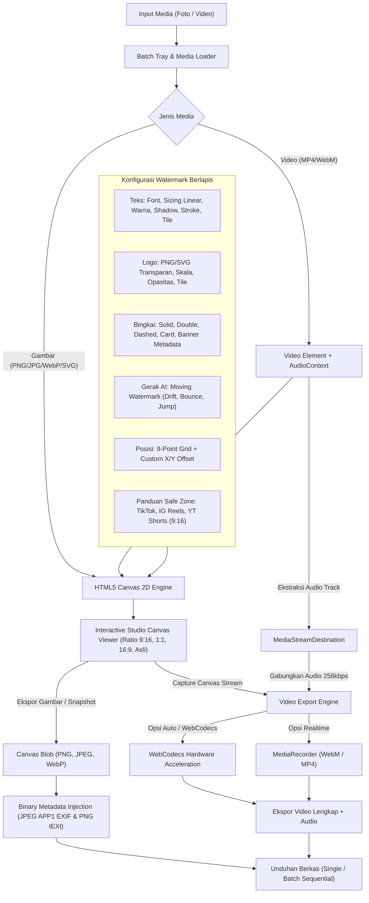

# MarkIt Studio: Studio Watermark Foto dan Video Client-Side

MarkIt Studio adalah aplikasi web dan Progressive Web App (PWA) modern untuk membubuhkan watermark pada foto dan video langsung di browser. Pemrosesan media berjalan 100% di sisi klien (client-side) menggunakan HTML5 Canvas 2D, Web Audio API, WebCodecs API, dan MediaRecorder API tanpa mengunggah berkas ke server atau cloud pihak ketiga.

Proyek ini dibangun di atas **Next.js 16 (App Router)**, **React 19**, **Tailwind CSS v4**, dan **TypeScript 6 (Strict Mode)** dengan pengelola paket **Bun**.

---

## Arsitektur Pemrosesan Media (Client-Side Pipeline)

Diagram berikut mengilustrasikan alur kerja pemrosesan media di memori browser pengguna:



---

## Fitur Utama

### 1. 100% Client-Side dan Privasi Penuh
Seluruh proses decoding media, perenderan layer watermark, manipulasi byte binary metadata, dan encoding berkas berlangsung lokal di memori browser. Berkas foto dan video Anda tidak pernah dikirimkan ke server eksternal, sehingga data pribadi dan aset rahasia tetap aman.

### 2. Moving Watermark (Proteksi Anti-AI Inpainting)
- **Modus Pergeseran Dinamis:**
  - `drift`: Gerakan melayang harmonik halus menggunakan gelombang sinus matematika deterministik.
  - `bounce`: Gerakan memantul dari tepi layar menyerupai screensaver.
  - `jump`: Berpindah sudut atau kuadran secara periodik setiap beberapa detik.
- **Pengaturan Kecepatan:** Pilihan kecepatan Lambat (Subtle), Sedang (Normal), dan Cepat (Agresif).
- **Sinkronisasi Presisi:** Koordinat dihitung per detik waktu video (`currentTime`), menghasilkan animasi yang mulus saat preview, scrubbing, maupun rendering frame demi frame.
- **Preset Khusus:** Preset bawaan `anti-ai-dynamic` siap pakai dalam satu klik.

### 3. Eksplorasi Akselerasi WebCodecs & Multi-Engine Video
- **Deteksi Native Hardware:** Mendeteksi otomatis dukungan browser terhadap `VideoEncoder` dan `VideoFrame` API native.
- **Pilihan Engine Ekspor:**
  - `auto`: Mengutamakan akselerasi hardware WebCodecs jika didukung, dengan fallback otomatis ke MediaRecorder.
  - `realtime`: Menggunakan MediaRecorder native browser yang stabil.
- **Indikator Resolusi & Bitrate Adaptif:**
  - Menghitung bitrate optimal secara otomatis (720p HD 8-16 Mbps, 1080p FHD 16-24 Mbps, 1440p 2K 20-36 Mbps, 4K UHD 24-50 Mbps).
  - Audio fidelitas tinggi 256 kbps stereo.

### 4. Stempel Metadata EXIF & Hak Cipta Binary
Penyematan informasi hak cipta langsung ke tingkat byte binary tanpa dependensi pustaka berat:
- **Format JPEG (APP1 Segment & TIFF IFD0):** Menyuntikkan tag Software (`0x0131`), ImageDescription (`0x010E`), Artist (`0x013B`), dan Copyright (`0x8298`) tepat setelah marker SOI (`0xFF 0xD8`).
- **Format PNG (tEXt Chunks):** Menyuntikkan chunk teks ISO-8859-1 `Author`, `Copyright`, `Description`, dan `Software` lengkap dengan checksum CRC32 valid sebelum marker `IEND`.
- **Integrasi Otomatis:** Terpasang pada ekspor gambar tunggal, batch export, maupun snapshot frame video.

### 5. Panduan Safe Zone Sosial Media & Mockup UI
- **Template Sosmed Populer:** Panduan area aman terkalibrasi khusus untuk format vertikal 9:16 (720 x 1280 px):
  - **TikTok:** Menandai header atas, tombol interaksi vertikal kanan, serta caption profil bawah.
  - **Instagram Reels:** Menandai area aman dari tombol like, komentar, dan nama akun.
  - **YouTube Shorts:** Menandai area bebas tombol jempol, remix, dan judul video.
- **Overlay Interaktif:** Opsi menyalakan/mematikan visual zona bahaya (merah), batas aman (hijau), mockup tombol sosmed, serta siklus opasitas overlay.
- **Pengalih Rasio Pratinjau Studio:** Pilihan instan antara 9:16 Vertikal, 1:1 Persegi, 16:9 Lanskap, dan Rasio Asli Media.

### 6. Kontrol Scrubber Video & Stepper Frame Presisi
- **Timeline Interaktif:** Scrubbing waktu presisi dengan track visual bergradien, badge timecode (`mm:ss / mm:ss`), dan status durasi aman.
- **Frame Stepper (±1f):** Tombol maju dan mundur 1 frame (0.033 detik) untuk navigasi detail.
- **Pintasan Keyboard Lengkap:**
  - `Spasi`: Putar / Jeda video.
  - `Panah Kiri / Kanan`: Geser mundur / maju 1 detik (tahan `Shift` untuk lompat 5 detik).
  - `,` (Koma) / `.` (Titik): Mundur / maju 1 frame.
  - `M`: Bisukan / aktifkan suara.
  - `Panah Atas / Bawah`: Naikkan / turunkan volume (kelipatan 5%).

### 7. Snapshot Frame Native Video
Mengekstrak frame video aktif langsung dari buffer decoder perangkat keras pada resolusi penuh tanpa distorsi kompresi layar viewport.

### 8. Kustomisasi Watermark Berlapis
- **Watermark Teks:**
  - 10 jenis huruf terkurasi dari Google Fonts dalam 5 kategori: Modern Sans, Serif, Display/Bold, Script/Handwritten, dan Monospace.
  - Validasi kesiapan font via `document.fonts.load()`.
  - Sistem ukuran persentase linear (0.5% hingga 30.0%) dengan 5 preset ukuran instan.
  - Warna kustom hex picker, transparansi (opasitas), rotasi (-180° hingga 180°), bayangan (shadow), dan garis tepi (stroke).
  - Pola ubin berulang diagonal (tile pattern) dengan kerapatan pixel yang dapat diatur.
- **Watermark Logo:** Unggah logo transparan (PNG/SVG), kontrol skala (%), opasitas, rotasi, dan pola ubin logo.
- **Bingkai dan Border:** Garis solid, garis ganda, garis putus-putus, kartu foto polaroid, serta banner metadata fotografi ("Shot on MarkIt").
- **Kisi Posisi 9-Grid:** Penempatan instan pada 9 titik kisi ditambah slider offset horizontal dan vertikal.

### 9. Antrean Batch Processing
- Unggah banyak foto dan video sekaligus melalui tombol file picker atau drag and drop.
- Terapkan konfigurasi watermark ke seluruh antrean secara konsisten.
- Ekspor sekuensial yang andal: kegagalan pada satu berkas tidak membatalkan sisa antrean batch.

### 10. PWA dan Desain Responsif
- **Progressive Web App (PWA):** Dikonfigurasi dengan Serwist Service Worker untuk performa offline-first dan dapat diinstal langsung di layar beranda ponsel maupun desktop.
- **Tema Terang & Gelap:** Dukungan tema Terang, Gelap, dan Sistem berbasis token Tailwind CSS v4 dan `next-themes`.
- **Internasionalisasi:** Lokalisasi berbasis cookie tanpa prefix URL, mendukung Bahasa Indonesia (`id`) dan Bahasa Inggris (`en`).

### 11. Keamanan & Rate Limiting
- Gerbang keamanan `src/proxy.ts` yang memblokir pemindaian kerentanan otomatis dan path traversal (HTTP 403).
- Rate limiter in-memory sliding window berdasarkan tier endpoint (Standard, Moderate, Strict) dengan respon HTTP 429 dan header `Retry-After`.
- Modul enkripsi AES-256-GCM (`src/lib/crypto.ts`) dan penyamaran ID integer Sqids (`src/lib/obfuscator.ts`).

---

## Struktur Folder Proyek

```
mark-it/
├── .github/workflows/         # Pipeline CI GitHub Actions (Lint, Test, Build)
├── cli/                       # Helper perkakas baris perintah lokal (bun run cli)
│   ├── commands/              # Modul perintah CLI
│   └── index.ts               # Entrypoint parser argumen CLI
├── e2e/                       # Pengujian End-to-End Vitest & Bun
│   └── app.test.ts            # Skenario pengujian proxy, keamanan, metadata, PWA, engine
├── public/                    # Aset statis, ikon PWA, manifest
├── src/                       # Seluruh kode sumber aplikasi
│   ├── app/                   # Next.js App Router
│   │   ├── _components/       # Komponen tema dan pengalih bahasa
│   │   ├── favicon.ico        # Ikon tab peramban
│   │   ├── globals.css        # Desain token CSS & konfigurasi Tailwind v4
│   │   ├── layout.tsx         # Root layout (Metadata SEO, ThemeProvider)
│   │   ├── manifest.ts        # PWA Web App Manifest
│   │   ├── page.tsx           # Halaman utama MarkIt Studio
│   │   ├── providers.tsx      # Provider next-themes
│   │   ├── robots.ts          # Generator robots.txt
│   │   ├── sitemap.ts         # Generator sitemap.xml
│   │   └── sw.ts              # Service Worker PWA (Serwist)
│   ├── components/            # Komponen antarmuka modular
│   │   ├── landing/           # Bagian halaman beranda (Hero, Fitur, Cara Kerja, Preset, FAQ)
│   │   ├── layout/            # Header dan Footer aplikasi
│   │   ├── studio/            # Komponen editor studio (Canvas, Inspector, Batch Tray, Export, Social Frame)
│   │   └── ui/                # Komponen primitif UI (Button, Slider, Switch, Badge, ColorPicker)
│   ├── data/                  # Data statis dan koleksi konfigurasi
│   │   ├── fonts.ts           # Daftar 10 Google Fonts terkurasi & preset ukuran
│   │   ├── navigation.ts      # Menu navigasi header dan footer
│   │   └── presets.ts         # Template preset watermark 1-klik (termasuk Anti-AI & Sosmed)
│   ├── dictionaries/          # Berkas terjemahan bahasa
│   │   ├── en.json            # Terjemahan Bahasa Inggris
│   │   └── id.json            # Terjemahan Bahasa Indonesia (default)
│   ├── i18n/                  # Konfigurasi locale
│   │   └── config.ts          # Definisi tipe dan daftar bahasa yang didukung
│   ├── lib/                   # Utilitas logika dan engine
│   │   ├── __tests__/         # Unit test untuk seluruh fungsi utilitas
│   │   ├── crypto.ts          # Enkripsi & Dekripsi AES-256-GCM (server-only)
│   │   ├── dictionaries.ts    # Loader terjemahan (server-only)
│   │   ├── i18n-actions.ts    # Server action untuk pengubahan cookie bahasa
│   │   ├── i18n-server.ts     # Pengambil locale di Server Components
│   │   ├── obfuscator.ts      # Penyamaran ID integer Sqids
│   │   ├── rate-limiter.ts    # Rate limiting berbasis in-memory sliding window
│   │   ├── security-guards.ts # Pendeteksi path traversal dan bot mencurigakan
│   │   ├── seo.ts             # Metadata SEO dan generator JSON-LD
│   │   └── watermark-engine.ts# Core engine canvas, video encoder, WebCodecs, EXIF & PNG stumper
│   ├── proxy.ts               # Handler middleware keamanan dan rate limit
│   └── types/                 # Definisi tipe data TypeScript
│       └── watermark.ts       # Interface media, watermark, gerak AI, metadata, dan ekspor
├── workflow/                  # Dokumentasi alur kerja tim (PRD, Desain, Build, QA, Signoff)
├── .env                       # Berkas variabel lingkungan tunggal
├── AGENTS.md                  # Panduan agen AI
├── GUIDELINE.md               # Standar arsitektur dan konvensi kode
├── next.config.ts             # Konfigurasi Next.js
├── package.json               # Dependensi paket dan skrip npm
├── postcss.config.mjs          # Konfigurasi PostCSS Tailwind v4
└── tsconfig.json              # Konfigurasi TypeScript Strict
```

---

## Panduan Memulai

### Prasyarat
Pastikan sistem Anda telah terpasang:
- **Bun** (versi 1.2 atau lebih baru)
- Peramban web modern yang mendukung HTML5 Canvas, Web Audio API, dan MediaRecorder / WebCodecs (Chrome, Edge, Firefox, atau Safari versi terbaru)

### 1. Pemasangan Dependensi
Pasang seluruh paket pustaka:
```bash
bun install
```

### 2. Menjalankan Server Pengembangan
Jalankan aplikasi di server lokal:
```bash
bun run dev
```
Buka alamat [http://localhost:3000](http://localhost:3000) pada peramban Anda.

### 3. Menjalankan Pengujian (Testing)
Jalankan pengujian unit (Unit Tests):
```bash
bun test
```

Jalankan pengujian end-to-end (E2E Tests):
```bash
bun test:e2e
```

### 4. Pemeriksaan Kode (Linting)
Jalankan ESLint untuk memastikan kerapian kode dan ketiadaan error:
```bash
bun run lint
```

### 5. Kompilasi Produksi (Build)
Uji kesiapan kompilasi bundel aplikasi Next.js:
```bash
bun run build
```

Jalankan server produksi lokal setelah kompilasi:
```bash
bun start
```

### 6. Menjalankan CLI Helper
Jalankan perkakas CLI bawaan proyek:
```bash
bun run cli --help
```

---

## Konfigurasi Lingkungan (.env)

Proyek ini menerapkan prinsip **satu berkas `.env` tunggal** untuk seluruh lingkungan kerja (tanpa `.env.local` atau `.env.production`).

| Variabel | Keterangan | Akses |
|---|---|---|
| `NEXT_PUBLIC_APP_NAME` | Nama publik aplikasi ("MarkIt Studio") | Klien & Server |
| `NEXT_PUBLIC_APP_VERSION` | Versi aplikasi | Klien & Server |
| `NEXT_PUBLIC_APP_URL` | URL dasar aplikasi untuk SEO & canonical link | Klien & Server |
| `NEXT_PUBLIC_ENABLE_PWA` | Mengaktifkan atau menonaktifkan fitur PWA | Klien & Server |
| `NEXT_PUBLIC_DEFAULT_LOCALE` | Bahasa default aplikasi (`id`) | Klien & Server |
| `ENCRYPTION_KEY` | Kunci rahasia 32 karakter (256-bit) untuk AES-GCM | Server Only |
| `SQIDS_ALPHABET` | Deret karakter alfabet acak untuk penyamaran ID Sqids | Server Only |

---

## Standar Kode dan Kualitas

- **Zero Suppression:** Dilarang menggunakan anotasi pengabaian tipe seperti `@ts-ignore` atau `eslint-disable`.
- **TypeScript Strict:** Seluruh modul menggunakan strict mode tanpa penggunaan tipe `any` implisit.
- **Client-Side Heavy, Zero Cloud Waste:** Fungsi watermarking tidak membebani server backend atau cloud compute, memastikan biaya operasional server tetap efisien.
- **Verifikasi Kualitas:** Terverifikasi lulus 171 pengujian unit engine dan 37 pengujian E2E integrasi secara berkelanjutan.
